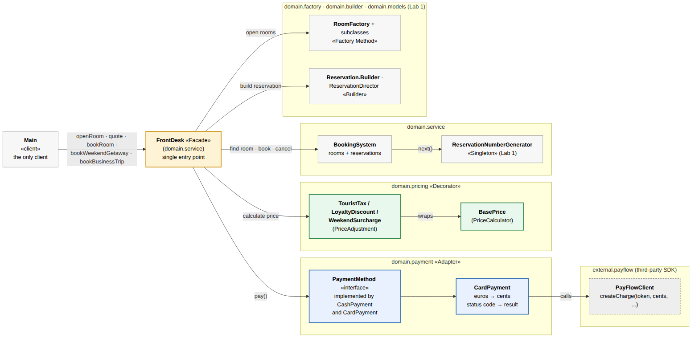
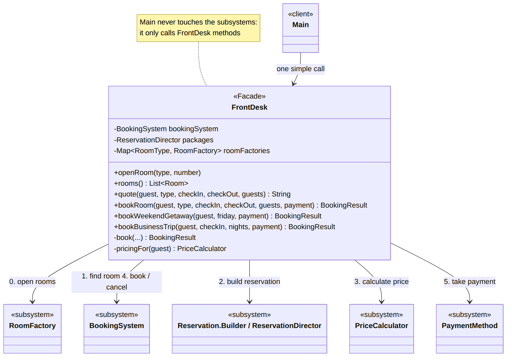
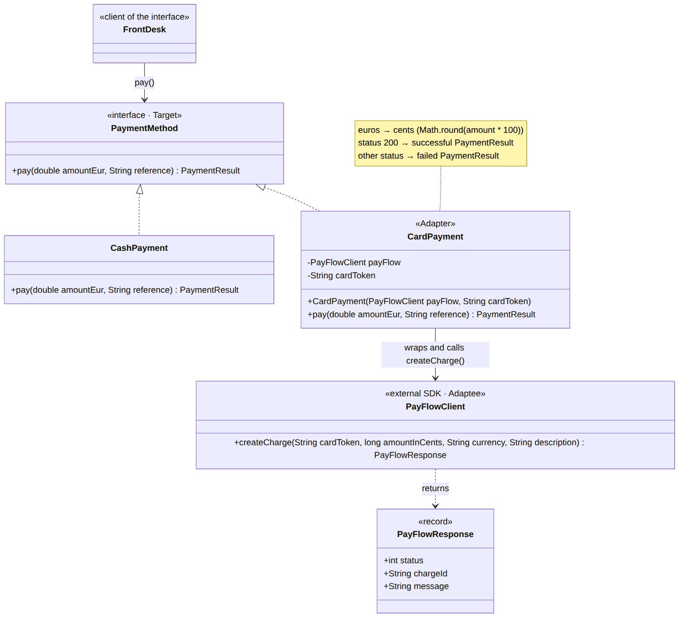
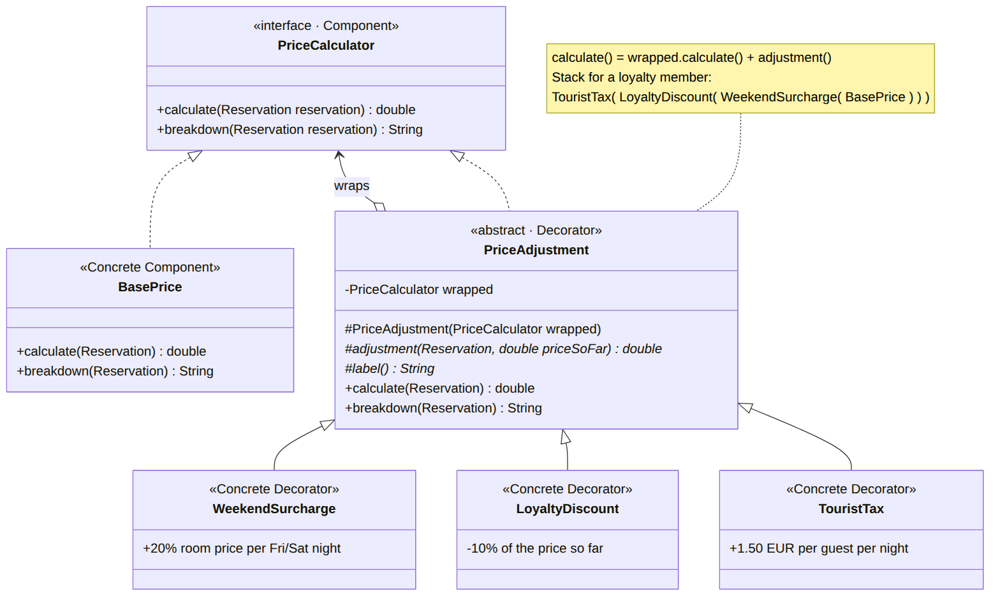
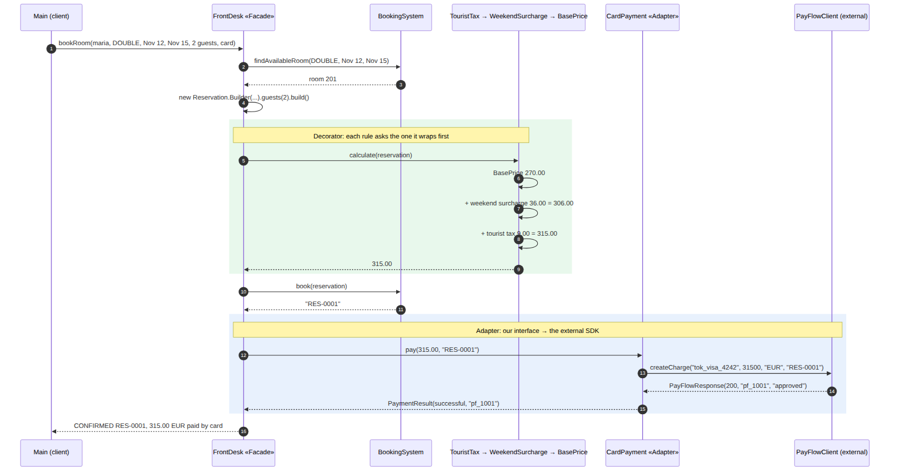

# Structural Design Patterns

## Author: Macari Chiril-Adam, FAF-243

**Checked by:** asist. univ. Istrati Daniel<br>
**Course:** Techniques and Mechanisms of Software Design<br>
**Laboratory Work No.2:** Structural Design Patterns<br>
**Domain:** Hotel booking system (continued from Laboratory Work No.1), implemented in Java (no frameworks or external libraries)

---

## 1. Objectives

- Study and understand the Structural Design Patterns;
- Think about the functionalities the hotel booking system needs to provide to its users;
- Extend the project from the previous laboratory work with at least 3 structural design patterns that help perform those tasks.

---

## 2. Theoretical Background

### 2.1 Overview

Structural design patterns describe **how classes and objects are combined into larger structures** while keeping those structures flexible and efficient. Creational patterns answer the question *how are objects created?*. Structural patterns answer *how do objects fit together?*: how to connect incompatible interfaces, add behaviour without changing a class, simplify a complicated subsystem or control access to an object.

Most structural patterns work by **wrapping** one object inside another and forwarding calls to it. They differ mainly in their *intent*: why the wrapper exists and what it adds.

| Pattern | Main idea |
|---|---|
| **Adapter** | Makes an incompatible interface usable by translating calls |
| **Bridge** | Splits an abstraction from its implementation so both can vary independently |
| **Composite** | Treats a single object and a group of objects in the same way (tree structures) |
| **Decorator** | Adds responsibilities to an object dynamically by wrapping it |
| **Facade** | Provides one simple entry point to a complex subsystem |
| **Flyweight** | Shares common data between many similar objects to save memory |
| **Proxy** | A placeholder that controls access to another object |

### 2.2 Adapter

**Intent.** Convert the interface of a class into another interface that clients expect, so classes with incompatible interfaces can work together.

**Structure.** *Target* (the interface the client uses), *Adaptee* (the existing class with a different interface, often third-party code that cannot be changed) and *Adapter* (implements the Target and translates every call to the Adaptee). The **object adapter** holds the adaptee as a field (composition). The **class adapter** extends the adaptee (inheritance), which is less flexible and needs multiple inheritance in some languages.

**When to use.** When you want to use an existing or external class whose interface does not match the rest of the code, for example a third-party library, a legacy module or an API that uses different units or formats.

**Drawbacks / when not to use.** It adds an extra class and a layer of indirection. If you control both sides, it is usually better to change one of the interfaces than to adapt it.

**In the hotel domain.** The external card provider works in cents and returns status codes; the hotel works in euros with its own `PaymentMethod` interface. An adapter connects them.

### 2.3 Bridge

**Intent.** Decouple an abstraction from its implementation so that the two can vary independently.

**Structure.** The *Abstraction* holds a reference to an *Implementor* interface and delegates the low-level work to it. *Refined Abstractions* extend the abstraction, and *Concrete Implementors* provide different implementations. Instead of one class hierarchy that grows in two dimensions (for example `EmailBookingNotice`, `SmsBookingNotice`, `EmailCancellationNotice`, `SmsCancellationNotice`), there are two small hierarchies connected by composition.

**When to use.** When a class varies in two independent dimensions (what it does and how or where it does it) and inheritance would cause a "class explosion".

**Drawbacks / when not to use.** It is more complex to design up front. If there is only one implementation, a Bridge is unnecessary.

**In the hotel domain.** Notifications (booking confirmation, cancellation, reminder) could be separated from the channel used to send them (email, SMS, push notification).

### 2.4 Composite

**Intent.** Compose objects into tree structures and let clients treat individual objects and groups of objects uniformly.

**Structure.** A *Component* interface is implemented both by a *Leaf* (a single object) and by a *Composite* (a container that holds children, which can be leaves or other composites). Operations on a composite are usually forwarded to all of its children and the results combined.

**When to use.** When the data naturally forms a part–whole hierarchy (files and folders, menus and submenus, an organisation chart) and the client should not care whether it deals with one element or a whole group.

**Drawbacks / when not to use.** It can make the design too general: it becomes harder to restrict which children a composite may contain. It is not useful for flat data.

**In the hotel domain.** Hotel → floors → rooms: asking the hotel for its total capacity or revenue would sum over all floors, and each floor sums over its rooms.

### 2.5 Decorator

**Intent.** Attach additional responsibilities to an object dynamically. Decorators provide a flexible alternative to subclassing for extending behaviour.

**Structure.** A *Component* interface, a *Concrete Component* (the basic object), an abstract *Decorator* that implements the Component **and holds a reference to another Component**, and *Concrete Decorators* that add their own behaviour before or after forwarding the call. Because a decorator is itself a Component, decorators can be wrapped inside each other in any combination, at runtime.

**When to use.** When behaviour should be combined freely (n features would otherwise need up to 2ⁿ subclasses), when it must be added or removed at runtime, or when a class cannot be subclassed.

**Drawbacks / when not to use.** Many small objects that look alike; the **order of wrapping matters**, which can cause subtle bugs; and debugging through several layers is harder. If there is only one fixed combination, a simple class is clearer.

**In the hotel domain.** Pricing rules (weekend surcharge, loyalty discount, tourist tax) are stacked on top of the base price, depending on the guest and the dates.

### 2.6 Facade

**Intent.** Provide a unified, simplified interface to a set of interfaces in a subsystem.

**Structure.** A *Facade* class knows which subsystem classes are responsible for a request and delegates to them in the right order. The subsystem classes do not know about the facade, and they can still be used directly when needed.

**When to use.** When a subsystem is complex and most clients need only a few common operations, or to reduce the dependencies between the client and the many classes of a subsystem.

**Drawbacks / when not to use.** The facade can grow into a "god object" that knows and does too much. If the subsystem is already simple, a facade only adds a layer.

**In the hotel domain.** A real hotel guest does not talk to the booking system, the payment terminal and the price list separately; they talk to the **front desk**.

### 2.7 Flyweight

**Intent.** Use sharing to support large numbers of fine-grained objects efficiently.

**Structure.** The state of an object is split into **intrinsic** state (shared, immutable, the same for many objects) and **extrinsic** state (unique, passed in or stored outside). A *Flyweight Factory* caches the flyweights and returns an existing one instead of creating a duplicate.

**When to use.** When an application needs a huge number of similar objects and memory becomes a problem, for example characters in a text editor, trees in a game or map markers. Java's `Integer.valueOf()` cache and `String` interning are flyweights.

**Drawbacks / when not to use.** The code becomes more complex, and the shared objects must be immutable. With a small number of objects the memory saved is negligible.

**In the hotel domain.** If the hotel had thousands of rooms, the data common to a room type (description, amenities, photos) could be stored once per type and shared, while each room keeps only its number and status.

### 2.8 Proxy

**Intent.** Provide a surrogate or placeholder for another object to control access to it.

**Structure.** The *Proxy* implements the same interface as the *Real Subject* and holds a reference to it. Before or after forwarding the call, it performs extra work. Common kinds are the **protection proxy** (checks permissions), the **virtual proxy** (creates an expensive object only when needed, i.e. lazy loading), the **remote proxy** (represents an object on another machine) and the **caching proxy**.

**When to use.** When access to an object must be controlled, delayed, logged or cached without changing the object itself or its clients.

**Drawbacks / when not to use.** It adds latency and another class; if the extra control is not needed, the proxy is useless.

**In the hotel domain.** A protection proxy could allow only managers to cancel reservations, forwarding the call to the real booking service only after checking the user's role.

### 2.9 Similar Wrappers, Different Intent

Adapter, Decorator, Proxy and Facade all "wrap" something, which makes them easy to confuse. The difference is in what the wrapper is for:

| Pattern | Interface offered to the client | Purpose |
|---|---|---|
| **Adapter** | A **different** interface than the wrapped object | Make an incompatible object fit |
| **Decorator** | The **same** interface | **Add** behaviour; can be stacked |
| **Proxy** | The **same** interface | **Control access** to the object |
| **Facade** | A **new, simpler** interface over **many** objects | Simplify a whole subsystem |
| **Bridge** | Designed up front, not wrapped afterwards | Let abstraction and implementation vary separately |

---

## 3. Used Design Patterns

- **Facade** — `FrontDesk`, the single entry point that hides the booking system, factories, builder, pricing and payment;
- **Adapter** — `CardPayment`, which adapts the external `PayFlowClient` SDK to the hotel's `PaymentMethod` interface;
- **Decorator** — `PriceAdjustment` and its subclasses `WeekendSurcharge`, `LoyaltyDiscount` and `TouristTax`, which wrap the `BasePrice`.

The creational patterns from Laboratory Work No.1 (Singleton, Factory Method and Builder) are still used, but they are now hidden inside the `FrontDesk` instead of being called by the client.

---

## 4. Implementation

### 4.1 What Changed Since Laboratory Work No.1

The project was extended with new functionality: price quotes with pricing rules, payments by cash or by card through an external provider, and a front desk that performs a complete booking in one call. Following the lab requirements, the object creation mechanisms are now **buried inside the functionality**: the client no longer calls the factories or the builder directly. There is **one client** (`Main`), and the files are grouped by responsibility. Class names describe their role in the hotel (`FrontDesk`, `CardPayment`, `TouristTax`) rather than the names of the patterns.

```
src/main/java/hotel/
├── client/
│   └── Main.java                     the only client
├── domain/
│   ├── models/                       Room, SingleRoom, DoubleRoom, Suite, RoomType,
│   │                                 Reservation (+ Builder), Guest, BookingResult
│   ├── factory/                      RoomFactory + 3 subclasses (Lab 1)
│   ├── builder/                      ReservationDirector (Lab 1)
│   ├── service/
│   │   ├── FrontDesk.java            Facade
│   │   ├── BookingSystem.java        rooms + reservations
│   │   └── ReservationNumberGenerator.java   Singleton (Lab 1)
│   ├── pricing/
│   │   ├── PriceCalculator.java      component interface
│   │   ├── BasePrice.java            concrete component
│   │   ├── PriceAdjustment.java      Decorator (abstract)
│   │   ├── WeekendSurcharge.java
│   │   ├── LoyaltyDiscount.java
│   │   └── TouristTax.java
│   └── payment/
│       ├── PaymentMethod.java        target interface
│       ├── PaymentResult.java
│       ├── CashPayment.java
│       └── CardPayment.java          Adapter
├── external/payflow/
│   ├── PayFlowClient.java            simulated third-party SDK (adaptee)
│   └── PayFlowResponse.java
└── utilities/
    └── Money.java                    formats amounts the same on every computer
```

Figure 1 shows the architecture: the client talks only to the `FrontDesk`, which coordinates the Lab 1 creational parts, the booking system, the pricing rules and the payment methods.



*Figure 1. Architecture of the extended hotel booking system (orange: Facade, blue: Adapter, green: Decorator)*

### 4.2 Facade — FrontDesk

Making a booking involves many subsystems: finding a free room, building the reservation, calculating the price, reserving the room, getting a confirmation code and taking the payment. The `FrontDesk` offers a few simple methods (`openRoom`, `quote`, `bookRoom`, `bookWeekendGetaway`, `bookBusinessTrip`) and performs all of these steps internally, in the right order.



*Figure 2. Facade: the client calls only FrontDesk, which coordinates five subsystems*

The public methods are short: each one only says which room type and which reservation recipe to use, and passes the rest to a private method that contains the common steps:

```java
public BookingResult bookWeekendGetaway(Guest guest, LocalDate friday, PaymentMethod payment) {
    return book(guest, RoomType.SUITE, friday, friday.plusDays(2), payment,
            room -> packages.weekendGetaway(guest.name(), room, friday));
}
```

```java
// the steps every booking goes through, hidden from the client
private BookingResult book(Guest guest, RoomType type, LocalDate checkIn, LocalDate checkOut,
                           PaymentMethod payment, Function<Room, Reservation> createReservation) {
    // 1. find a free room
    Optional<Room> room = bookingSystem.findAvailableRoom(type, checkIn, checkOut);
    if (room.isEmpty()) {
        return BookingResult.rejected(guest.name(), "no " + type + " room free from " + checkIn + " to " + checkOut);
    }
    // 2. build the reservation (Builder / Director)
    Reservation reservation;
    try {
        reservation = createReservation.apply(room.get());
    } catch (IllegalStateException e) {
        return BookingResult.rejected(guest.name(), e.getMessage());
    }
    // 3. calculate the price with the pricing rules that apply to this guest
    PriceCalculator pricing = pricingFor(guest);
    double price = pricing.calculate(reservation);
    // 4. reserve the room and get a confirmation code
    String code = bookingSystem.book(reservation).orElseThrow();
    // 5. take the payment; if it fails, release the room again
    PaymentResult paid = payment.pay(price, code);
    if (!paid.successful()) {
        bookingSystem.cancel(code);
        return BookingResult.rejected(guest.name(), paid.message() + " (" + code + " cancelled)");
    }
```

Thanks to the facade, the client stays short and readable. It never touches a factory, a builder, the booking system or a pricing rule:

```java
results.add(frontDesk.bookRoom(maria, RoomType.DOUBLE, nov12, nov15, 2, new CardPayment(payFlow, "tok_visa_4242")));
results.add(frontDesk.bookWeekendGetaway(ion, nov13, new CashPayment()));
results.add(frontDesk.bookBusinessTrip(elena, nov10, 2, new CardPayment(payFlow, "tok_visa_0000")));
```

### 4.3 Adapter — CardPayment

Card payments are processed by an external provider, simulated by the `PayFlowClient` class in the `external.payflow` package. Like a real third-party SDK, its interface does not match the hotel's code, and it cannot be changed: it expects the amount **in cents**, an ISO currency code, and it answers with an HTTP-like **status code**.

```java
public PayFlowResponse createCharge(String cardToken, long amountInCents, String currency, String description) {
    if (amountInCents <= 0) {
        return new PayFlowResponse(400, null, "amount must be positive");
    }
    if (cardToken.endsWith("0000")) {
        return new PayFlowResponse(402, null, "card declined");
    }
    return new PayFlowResponse(200, "pf_" + nextChargeId++, "approved");
}
```

The rest of the hotel works with its own, simpler interface, the **Target**, which uses euros and a simple success/failure result:

```java
public interface PaymentMethod {

    PaymentResult pay(double amountEur, String reference);
}
```

`CashPayment` implements this interface directly. `CardPayment` is the **Adapter**: it implements `PaymentMethod`, holds a `PayFlowClient` (the **Adaptee**), converts euros to cents before the call and turns PayFlow's status code into a `PaymentResult` after it.



*Figure 3. Adapter: CardPayment implements the hotel's PaymentMethod and translates every call to the external PayFlowClient*

```java
@Override
public PaymentResult pay(double amountEur, String reference) {
    long amountInCents = Math.round(amountEur * 100);
    PayFlowResponse response = payFlow.createCharge(cardToken, amountInCents, "EUR", reference);
    if (response.status() == 200) {
        return new PaymentResult(true, response.chargeId(), "paid by card");
    }
    return new PaymentResult(false, null, "card payment failed: " + response.message());
}
```

The `FrontDesk` only calls `payment.pay(price, code)` and does not know whether the guest pays in cash or by card. If the hotel changes its card provider, only a new adapter has to be written; the front desk and the rest of the code stay the same.

### 4.4 Decorator — Pricing Rules

The final price of a stay depends on several rules that apply only in some cases: a **weekend surcharge** of +20% of the room price for every Friday and Saturday night, a **loyalty discount** of −10% for loyalty members and a **tourist tax** of 1.50 EUR per guest per night. Writing a subclass for every combination would lead to many classes (`BasePriceWithTaxAndDiscount`, ...). Instead, every rule is a small object that **wraps** the price calculated so far.



*Figure 4. Decorator: every PriceAdjustment is a PriceCalculator that wraps another PriceCalculator*

All rules and the base price implement the same interface, the **Component**:

```java
public interface PriceCalculator {

    double calculate(Reservation reservation);

    // human-readable list of every step, e.g. "room and extras 270.00 + tourist tax 9.00"
    String breakdown(Reservation reservation);
}
```

The abstract **Decorator** `PriceAdjustment` holds the wrapped `PriceCalculator`. Its `calculate()` first asks the wrapped object for the price so far and then adds its own adjustment, so each rule only needs to define `adjustment()` and `label()`:

```java
private final PriceCalculator wrapped;

protected PriceAdjustment(PriceCalculator wrapped) {
    this.wrapped = wrapped;
}

// positive = surcharge, negative = discount
protected abstract double adjustment(Reservation reservation, double priceSoFar);

protected abstract String label();

@Override
public double calculate(Reservation reservation) {
    double priceSoFar = wrapped.calculate(reservation);
    return priceSoFar + adjustment(reservation, priceSoFar);
}
```

A **Concrete Decorator** defines only its own rule. For example, the weekend surcharge counts the Friday and Saturday nights of the stay:

```java
@Override
protected double adjustment(Reservation reservation, double priceSoFar) {
    long weekendNights = reservation.getCheckIn().datesUntil(reservation.getCheckOut())
            .filter(night -> night.getDayOfWeek() == DayOfWeek.FRIDAY
                    || night.getDayOfWeek() == DayOfWeek.SATURDAY)
            .count();
    return weekendNights * reservation.getRoom().getPricePerNight() * RATE;
}
```

The rules are combined at runtime, inside the facade, depending on the guest. The order matters: the tourist tax is added last, so it is never discounted.

```java
// stacks the pricing rules that apply to this guest
private PriceCalculator pricingFor(Guest guest) {
    PriceCalculator pricing = new BasePrice();
    pricing = new WeekendSurcharge(pricing);
    if (guest.loyaltyMember()) {
        pricing = new LoyaltyDiscount(pricing);
    }
    pricing = new TouristTax(pricing);   // added last, so taxes are never discounted
    return pricing;
}
```

For a loyalty member the result is the object chain `TouristTax(LoyaltyDiscount(WeekendSurcharge(BasePrice)))`. A new rule, for example a seasonal discount, can be added as one new class without changing the existing ones.

### 4.5 Runtime Flow

Figure 5 shows what happens when the client books Maria's stay with a card. The `FrontDesk` finds a free room and builds the reservation. The pricing chain then calculates the price: each decorator first asks the object it wraps, and adds its own amount on the way back. The booking system reserves the room and returns `RES-0001`. Finally, the `CardPayment` adapter converts 315.00 EUR into 31500 cents for the external SDK and converts its status code 200 back into a successful `PaymentResult`.



*Figure 5. Sequence diagram: Facade, Decorator and Adapter working together during one booking*

---

## 5. Results

Running `hotel.client.Main` produces the following output:

```
=== Opening the hotel ===
[ReservationNumberGenerator] Single instance created
Room 101 (SINGLE) - 60 EUR/night, up to 1 guest(s), Wi-Fi, Work desk
Room 102 (SINGLE) - 60 EUR/night, up to 1 guest(s), Wi-Fi, Work desk
Room 201 (DOUBLE) - 90 EUR/night, up to 2 guest(s), Wi-Fi, Queen bed, City view
Room 202 (DOUBLE) - 90 EUR/night, up to 2 guest(s), Wi-Fi, Queen bed, City view
Room 301 (SUITE) - 180 EUR/night, up to 4 guest(s), Wi-Fi, King bed, Living room, Jacuzzi

=== Price quotes: double room, 2 guests, Nov 12-15 ===
Regular guest:  room and extras 270.00 + weekend surcharge 36.00 + tourist tax 9.00 = 315.00 EUR
Loyalty member: room and extras 270.00 + weekend surcharge 36.00 - loyalty discount 30.60 + tourist tax 9.00 = 284.40 EUR

=== Bookings through the front desk ===
CONFIRMED RES-0001 | Maria Popescu | room 201 (DOUBLE) | 2026-11-12 -> 2026-11-15 | 315.00 EUR paid by card (pf_1001)
          price: room and extras 270.00 + weekend surcharge 36.00 + tourist tax 9.00
CONFIRMED RES-0002 | Ion Rusu | room 301 (SUITE) | 2026-11-13 -> 2026-11-15 | 448.80 EUR paid in cash (cash receipt #1)
          price: room and extras 420.00 + weekend surcharge 72.00 - loyalty discount 49.20 + tourist tax 6.00
REJECTED | Elena Ciobanu | card payment failed: card declined (RES-0003 cancelled)
CONFIRMED RES-0004 | Elena Ciobanu | room 101 (SINGLE) | 2026-11-10 -> 2026-11-12 | 203.00 EUR paid in cash (cash receipt #2)
          price: room and extras 200.00 + tourist tax 3.00
REJECTED | Andrei Lungu | Room 102 (SINGLE) fits at most 1 guest(s), requested 3
REJECTED | Victor Moraru | no SUITE room free from 2026-11-14 to 2026-11-16

Confirmed: 3 of 6 requests, revenue: 966.80 EUR
```

The output confirms that each pattern works as intended:

- **Decorator:** the two quotes are for the same stay, but a different chain of rules is built for each guest. The stay from Thursday to Sunday has 2 weekend nights, so the surcharge is 2 × 90 × 20% = 36.00 EUR, and the tourist tax is 2 guests × 3 nights × 1.50 = 9.00 EUR. For the loyalty member, the discount is 10% of 306.00 = 30.60 EUR, and the tax is added after the discount. Elena's business trip (Tuesday to Thursday) has no weekend nights, so the weekend rule adds nothing and does not appear in her breakdown.
- **Adapter:** Maria's 315.00 EUR were sent to PayFlow as 31500 cents and approved with charge `pf_1001`. Elena's first card was declined (status 402): the adapter turned this into a failed `PaymentResult`, and the front desk cancelled the reservation `RES-0003`. Her second attempt in cash, through the same `PaymentMethod` interface, was confirmed as `RES-0004`.
- **Facade:** each line of the client produced a complete booking or a clear rejection: no free suite for Victor, and the builder's validation for Andrei (3 guests do not fit in a single room). The client never handled these subsystems itself.
- **Lab 1 patterns still at work:** the rooms were created by the factories, the reservations by the builder and its director, and the confirmation codes came from the single number generator.

---

## 6. Conclusions

In this laboratory work I studied the structural design patterns and extended the hotel booking system from the previous laboratory work with three of them, each solving a real problem of the domain:

- **Facade** gave the system a single entry point. The `FrontDesk` hides six steps and five subsystems behind a few methods, so the client became short and easy to read, and the creational patterns from Lab 1 are now used inside the functionality instead of in the client.
- **Adapter** made it possible to use an external payment SDK with a different interface (cents, currency codes, status codes) without changing it and without letting its details spread through the hotel's code. Changing the payment provider would only require a new adapter.
- **Decorator** turned the pricing rules into small, independent objects that are combined at runtime. Different guests get different combinations of rules without a subclass for every combination, and new rules can be added without touching the existing code. I also saw that the order of the decorators matters, since the tax must be added after the discount.

The three patterns complement each other: the facade decides which pricing rules (decorators) apply and which payment method (possibly the adapter) is used, while the client only describes what the guest wants. The remaining structural patterns — Bridge, Composite, Flyweight and Proxy — were described in the theoretical part with examples of how they could extend this project further.

Overall, structural patterns organise how existing objects fit together, which keeps a growing system flexible: new features were added mostly by writing new classes instead of modifying existing ones.

---

## How to Run

Requirements: JDK 17 or newer. No frameworks or external libraries are used.

**IntelliJ IDEA:** File → Open… → select the `lab2` folder (or its `pom.xml`) → open `src/main/java/hotel/client/Main.java` → click the green arrow next to `main`.

**Command line:**

```bash
cd lab2
mkdir -p out
javac -d out $(find src -name "*.java")
java -cp out hotel.client.Main
```

The report is also available in Word format: [`report/Report_Lab2.docx`](report/Report_Lab2.docx). The diagrams are in [`diagrams/`](diagrams): PNG images plus their Mermaid sources (`.mmd`).

---

## References

- Vasile Drumea, *Structural Design Patterns*, Software Design Techniques and Mechanisms, Technical University of Moldova.
- E. Gamma, R. Helm, R. Johnson, J. Vlissides, *Design Patterns: Elements of Reusable Object-Oriented Software*, Addison-Wesley, 1994.
- SourceMaking, *Structural patterns*: https://sourcemaking.com/design_patterns/structural_patterns
