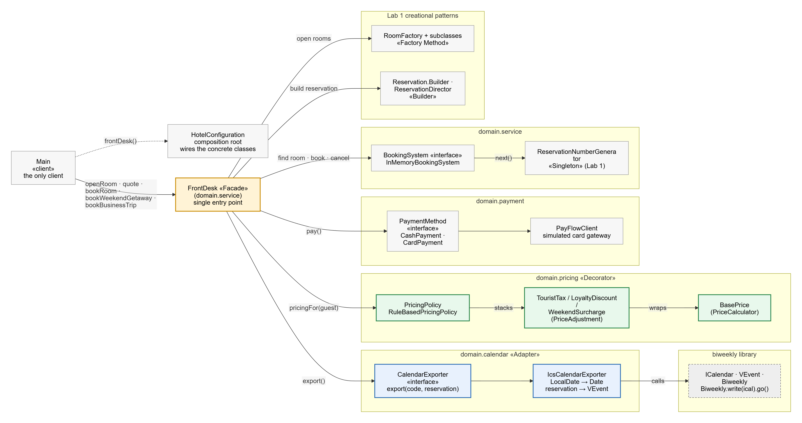
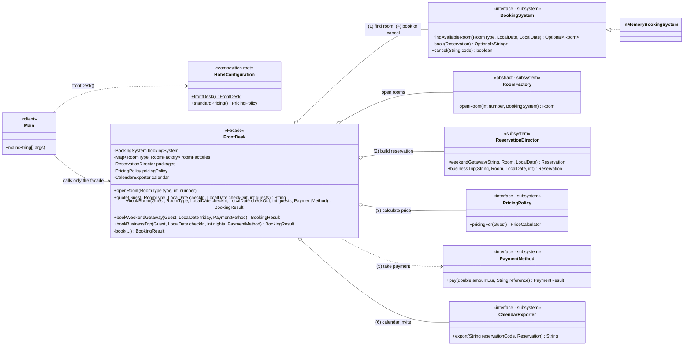
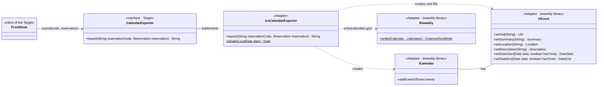
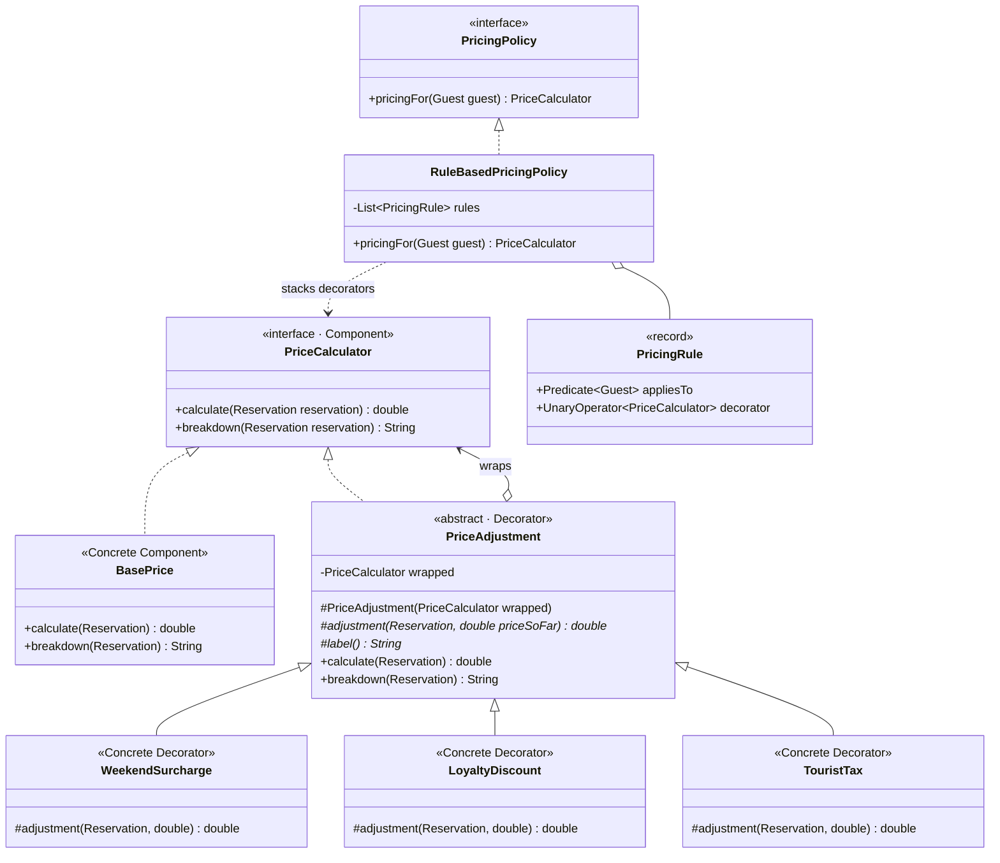
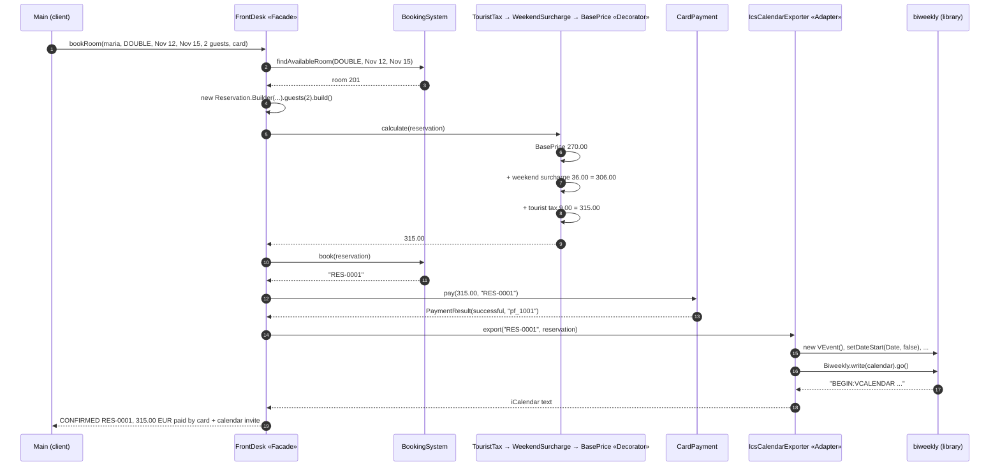

# Structural Design Patterns

## Author: Macari Chiril-Adam, FAF-243

**Checked by:** asist. univ. Istrati Daniel<br>
**Course:** Techniques and Mechanisms of Software Design<br>
**Laboratory Work No.2:** Structural Design Patterns<br>
**Patterns implemented:** Facade, Adapter, Decorator<br>
**Language:** Java 17, Maven (JUnit 5 for tests, the `biweekly` iCalendar library as the adapted third-party code)

---

## 1. Domain Description

The application is the **hotel booking system** from Laboratory Work No.1, extended with the work a real front desk does. A guest can ask for a **price quote**, **book** a room (a custom stay or one of the hotel's packages), **pay** in cash or by card, and receive a **calendar invite** (an `.ics` file) for the stay. The price depends on rules that apply only in some cases: a weekend surcharge, a loyalty discount and the city tourist tax. If the payment fails, the reservation is cancelled again.

The creational patterns from Lab 1 still create the objects the structural patterns work with: rooms come from the **Factory Method** (`RoomFactory`), reservations from the **Builder** (`Reservation.Builder`, `ReservationDirector`) and confirmation codes from the **Singleton** (`ReservationNumberGenerator`).

| Pattern | Where | Real problem it solves here |
|---|---|---|
| **Facade** | `FrontDesk` | A booking touches six subsystems in a fixed order (find room → build reservation → price → reserve → pay → invite). The client should make one call, not orchestrate them. |
| **Adapter** | `IcsCalendarExporter` → `biweekly` library | The hotel wants a simple `export(code, reservation)`; the real `biweekly` library has its own object model (`ICalendar`, `VEvent`), uses `java.util.Date` instead of `LocalDate` and writes text through a chained writer. |
| **Decorator** | `PriceAdjustment` + `WeekendSurcharge`, `LoyaltyDiscount`, `TouristTax` around `BasePrice` | Pricing rules apply in different combinations per guest and stay. A subclass per combination would explode; wrappers are combined at runtime. |

**The patterns interact on one execution path.** Every booking goes
`Main → FrontDesk (Facade) → PricingPolicy → TouristTax → … → BasePrice (Decorator chain) → PaymentMethod → IcsCalendarExporter (Adapter) → biweekly`
(see the sequence diagram in section 5).



*Figure 1. Architecture (orange: Facade, blue: Adapter, green: Decorator). Every diagram in this report also exists as a PNG in [`diagrams/`](diagrams), rendered from its Mermaid source (`.mmd`).*

### Project structure

```
lab2/
├── pom.xml, mvnw, mvnw.cmd               Maven build + wrapper (no Maven install needed)
├── README.md                             build, run and test instructions
├── REPORT.md                             this report
├── diagrams/                             Mermaid sources of all diagrams
└── src/
    ├── main/java/hotel/
    │   ├── client/
    │   │   ├── Main.java                 the only client (talks to FrontDesk)
    │   │   └── HotelConfiguration.java   composition root: wires concrete classes
    │   ├── domain/
    │   │   ├── models/                   Room + subclasses, RoomType, Reservation (+ Builder), Guest, BookingResult
    │   │   ├── factory/                  RoomFactory + 3 subclasses           (Lab 1, Factory Method)
    │   │   ├── builder/                  ReservationDirector                  (Lab 1, Builder)
    │   │   ├── service/                  FrontDesk (Facade), BookingSystem + InMemoryBookingSystem,
    │   │   │                             ReservationNumberGenerator           (Lab 1, Singleton)
    │   │   ├── pricing/                  PriceCalculator, BasePrice, PriceAdjustment + 3 rules (Decorator),
    │   │   │                             PricingPolicy, RuleBasedPricingPolicy, PricingRule
    │   │   ├── calendar/                 CalendarExporter (Target), IcsCalendarExporter (Adapter)
    │   │   └── payment/                  PaymentMethod, CashPayment, CardPayment, PaymentResult
    │   ├── external/payflow/             PayFlowClient: simulated card gateway (offline demo)
    │   └── utilities/Money.java          formats amounts the same on every computer
    └── test/java/hotel/domain/
        ├── service/FrontDeskTest.java            Facade tests (stubs)
        ├── calendar/IcsCalendarExporterTest.java Adapter tests
        └── pricing/PricingDecoratorTest.java     Decorator tests
```

---

## 2. Facade — `FrontDesk`

**Problem.** Without a facade, the client had to know the factories, the builder and director, the booking system, the pricing rules, the payment method and the calendar export, and call them in the right order (including "cancel the room if the payment fails"). `FrontDesk` offers a few methods (`openRoom`, `quote`, `bookRoom`, `bookWeekendGetaway`, `bookBusinessTrip`) and only **coordinates**: each subsystem is injected through the constructor as an interface and does its own work. Which pricing rules apply is decided by the injected `PricingPolicy`, not by the facade, so it does not turn into a god class.

### 2.1 Class diagram



*Figure 2. Facade class diagram (image: [`diagrams/2-facade.png`](diagrams/2-facade.png))*

### 2.2 Code — [`FrontDesk.java`](src/main/java/hotel/domain/service/FrontDesk.java#L92-L126)

```java
private BookingResult book(Guest guest, RoomType type, LocalDate checkIn, LocalDate checkOut,
                           PaymentMethod payment, Function<Room, Reservation> createReservation) {
    // 1. find a free room
    Optional<Room> room = bookingSystem.findAvailableRoom(type, checkIn, checkOut);
    if (room.isEmpty()) {
        return BookingResult.rejected(guest.name(), "no " + type + " room free from " + checkIn + " to " + checkOut);
    }
    // 2. build the reservation (Builder / Director)
    Reservation reservation;
    try {
        reservation = createReservation.apply(room.get());
    } catch (IllegalStateException e) {
        return BookingResult.rejected(guest.name(), e.getMessage());
    }
    // 3. calculate the price with the pricing rules (decorators) that apply to this guest
    PriceCalculator pricing = pricingPolicy.pricingFor(guest);
    double price = pricing.calculate(reservation);
    // 4. reserve the room and get a confirmation code
    Optional<String> code = bookingSystem.book(reservation);
    // ... (rejected if the room was just taken)
    // 5. take the payment; if it fails, release the room again
    PaymentResult paid = payment.pay(price, code.get());
    if (!paid.successful()) {
        bookingSystem.cancel(code.get());
        return BookingResult.rejected(guest.name(), paid.message() + " (" + code.get() + " cancelled)");
    }
    // 6. create the calendar invite for the guest (Adapter over the biweekly library)
    String invite = calendar.export(code.get(), reservation);
    // ... format the details
    return BookingResult.confirmed(code.get(), guest.name(), details, price, invite);
}
```

This method is what makes `FrontDesk` a facade: it only calls the subsystems in a fixed order and decides what to do between the steps (stop, cancel, continue). Each step is a call on an interface (`BookingSystem`, `PricingPolicy`, `PaymentMethod`, `CalendarExporter`) received through the constructor, so the facade contains no pricing, storage or payment logic of its own.

### 2.3 Unit tests — [`FrontDeskTest.java`](src/test/java/hotel/domain/service/FrontDeskTest.java)

Every subsystem is replaced by a **stub** that writes what happened into a shared `calls` list, so the tests check the order of the calls, not only the final result.

| Test | What it proves |
|---|---|
| `bookingCallsTheSubsystemsInTheRightOrder` | A successful booking calls exactly: find room → calculate price → book room 201 → pay 100.00 for RES-TEST → export RES-TEST, and the invite ends up in the result. |
| `failedPaymentCancelsTheReservationAndSendsNoInvite` | When the payment fails, the facade calls `cancel(RES-TEST)` right after `pay`, and the calendar export is never called. |
| `noFreeRoomStopsBeforePricingAndPayment` | With no free room, only `findAvailableRoom` is called; no price is calculated and no payment is taken. |
| `quoteForTooManyGuestsReturnsAMessageInsteadOfThrowing` | A quote that the builder rejects (3 guests in a single room) returns a message instead of crashing (regression test for a bug in the first version). |

---

## 3. Adapter — `IcsCalendarExporter` (adaptee: the `biweekly` library)

**Problem.** After a confirmed booking the guest should receive a calendar invite. The iCalendar format (RFC 5545) is handled by **biweekly** (`net.sf.biweekly:biweekly:0.6.8`), a real third-party library from Maven Central that we did not design and cannot change. Its interface does not match ours:

| The hotel (Target `CalendarExporter`) | biweekly (Adaptee) |
|---|---|
| one call: `export(String code, Reservation reservation)` | build an object model: `new VEvent()`, many setters, `ICalendar.addEvent()` |
| dates are `java.time.LocalDate` | dates are `java.util.Date` plus a `hasTime` flag for all-day events |
| reservation code, room, guest | `Uid`, `Location`, `Summary`, `Description` properties |
| returns text | text is produced by a chained writer: `Biweekly.write(ical).go()` |

The rest of the hotel (the `FrontDesk` and the tests) uses only `CalendarExporter`. Changing to another calendar library or a calendar API means writing a new adapter class; nothing else changes.

### 3.1 Class diagram



*Figure 3. Adapter class diagram (image: [`diagrams/3-adapter.png`](diagrams/3-adapter.png))*

### 3.2 Code — [`IcsCalendarExporter.java`](src/main/java/hotel/domain/calendar/IcsCalendarExporter.java#L22-L42)

```java
@Override
public String export(String reservationCode, Reservation reservation) {
    VEvent stay = new VEvent();
    stay.setUid(reservationCode + "@" + HOTEL_DOMAIN);
    stay.setSummary("Hotel stay - room " + reservation.getRoom().getNumber()
            + " (" + reservation.getRoom().getType() + ")");
    stay.setLocation("Room " + reservation.getRoom().getNumber());
    stay.setDescription("Reservation " + reservationCode + " for " + reservation.getGuestName()
            + ", " + reservation.getGuests() + " guest(s), " + reservation.getNights() + " night(s)");
    // LocalDate -> java.util.Date; "false" = all-day event (no time of day)
    stay.setDateStart(toDate(reservation.getCheckIn()), false);
    stay.setDateEnd(toDate(reservation.getCheckOut()), false);

    ICalendar calendar = new ICalendar();
    calendar.addEvent(stay);
    return Biweekly.write(calendar).go();
}

private static Date toDate(LocalDate date) {
    return Date.from(date.atStartOfDay(ZoneId.systemDefault()).toInstant());
}
```

The adapter implements our one-method interface and translates every part of the call into biweekly's model: the reservation code becomes the event `UID`, the room becomes the `LOCATION`, and each `LocalDate` becomes a `java.util.Date` marked as all-day (`hasTime = false`). The library's chained writer then turns the object model back into the plain text our interface promises.

> `CardPayment` also converts between two interfaces (euros → cents, status code → `PaymentResult`), but its "gateway" `PayFlowClient` was written for this lab to keep the demo offline. It is therefore **not** presented as the Adapter; the graded Adapter is the one above, whose adaptee is real third-party code.

### 3.3 Unit tests — [`IcsCalendarExporterTest.java`](src/test/java/hotel/domain/calendar/IcsCalendarExporterTest.java)

The tests call the adapter **through the `CalendarExporter` interface** and read the result back with **biweekly's own parser**, so they check what the third-party library actually understood.

| Test | What it proves |
|---|---|
| `localDatesBecomeAllDayEventDates` | Check-in 2026-11-12 and check-out 2026-11-15 (`LocalDate`) arrive in the library as all-day dates (`hasTime() == false`) with the right year, month and day. |
| `reservationDataIsTranslatedIntoEventProperties` | The reservation code, room, room type, guest name, number of guests and nights are translated into `UID`, `LOCATION`, `SUMMARY` and `DESCRIPTION`. |
| `outputIsAStandardICalendarDocument` | The text starts with `BEGIN:VCALENDAR`, has `VERSION:2.0` and contains `DTSTART;VALUE=DATE:20261112` / `DTEND;VALUE=DATE:20261115`. |

---

## 4. Decorator — pricing rules

**Problem.** The final price depends on rules that apply only sometimes: **+20 %** of the room price for every Friday and Saturday night, **−10 %** for loyalty members and a **tourist tax** of 1.50 EUR per guest per night. With subclasses, every combination would need its own class (`PriceWithTaxAndDiscount`, …). Instead, every rule is a small object that **wraps** the price calculated so far and has the same interface, so rules can be stacked in any combination at runtime.

Which rules apply to which guest, and in which order, is described by a `PricingPolicy` built from a list of `PricingRule`s in the composition root:

```java
// HotelConfiguration.standardPricing(): the order matters, the tax is added last
return new RuleBasedPricingPolicy(List.of(
        PricingRule.always(WeekendSurcharge::new),
        PricingRule.when(Guest::loyaltyMember, LoyaltyDiscount::new),
        PricingRule.always(TouristTax::new)));
```

For a loyalty member this builds `TouristTax(LoyaltyDiscount(WeekendSurcharge(BasePrice)))`.

### 4.1 Class diagram



*Figure 4. Decorator class diagram (image: [`diagrams/4-decorator.png`](diagrams/4-decorator.png))*

### 4.2 Code — [`PriceAdjustment.java`](src/main/java/hotel/domain/pricing/PriceAdjustment.java#L11-L28) and [`RuleBasedPricingPolicy.java`](src/main/java/hotel/domain/pricing/RuleBasedPricingPolicy.java#L21-L30)

```java
public abstract class PriceAdjustment implements PriceCalculator {

    private final PriceCalculator wrapped;

    protected PriceAdjustment(PriceCalculator wrapped) {
        this.wrapped = wrapped;
    }

    // positive = surcharge, negative = discount
    protected abstract double adjustment(Reservation reservation, double priceSoFar);

    @Override
    public double calculate(Reservation reservation) {
        double priceSoFar = wrapped.calculate(reservation);
        return priceSoFar + adjustment(reservation, priceSoFar);
    }
}

// RuleBasedPricingPolicy: wraps the BasePrice with every rule that applies to the guest
public PriceCalculator pricingFor(Guest guest) {
    PriceCalculator pricing = new BasePrice();
    for (PricingRule rule : rules) {
        if (rule.appliesTo().test(guest)) {
            pricing = rule.decorator().apply(pricing);
        }
    }
    return pricing;
}
```

`PriceAdjustment` is a `PriceCalculator` **and** holds a `PriceCalculator`. Its `calculate()` first asks the wrapped object for the price so far and then adds its own amount, so decorators can be nested to any depth. The policy builds the nesting at runtime from the list of rules, so a new rule never requires a change in `PriceAdjustment`, in the policy or in the `FrontDesk`.

### 4.3 Unit tests — [`PricingDecoratorTest.java`](src/test/java/hotel/domain/pricing/PricingDecoratorTest.java)

Every test uses the same stay: double room (90 EUR/night), 2 guests, Thursday 12 → Sunday 15 November 2026 (3 nights, 2 of them on a weekend). Base 270.00, weekend surcharge 36.00, tourist tax 9.00.

| Test | What it proves |
|---|---|
| `eachDecoratorAddsItsAmountOnTopOfTheWrappedCalculator` | `TouristTax(WeekendSurcharge(BasePrice))` = 315.00, and the breakdown lists every layer in order. |
| `fixedAmountRulesGiveTheSameTotalInAnyOrder` | Rules that add a fixed amount (surcharge, tax) can be stacked in either order with the same result. |
| `percentageDiscountDependsOnOrderSoThePolicyAddsTheTaxLast` | A percentage discount does **not** commute: wrapping the tax inside the discount gives 283.50 (the tax would be discounted), the policy's order gives the correct 284.40. |
| `policyStacksOnlyTheRulesThatApplyToTheGuest` | The loyalty discount appears only for a loyalty member. |
| `newDecoratorIsAddedWithoutChangingExistingClasses` | An `EarlyBirdDiscount` written **only in the test** plugs into the policy and gives 295.00, without changing any existing class. |

---

## 5. How the Patterns Work Together

The sequence diagram shows the first booking of the demo (Maria, double room, paid by card): the facade drives the decorator chain and then the adapter, inside one call from the client.



*Figure 5. Runtime flow of one card booking (image: [`diagrams/5-runtime-flow.png`](diagrams/5-runtime-flow.png))*

### Client code depends on abstractions

`Main` talks only to `FrontDesk`. `FrontDesk` depends only on interfaces (`BookingSystem`, `PricingPolicy`, `PriceCalculator`, `PaymentMethod`, `CalendarExporter`) and on the abstract `RoomFactory`. The concrete classes are chosen in one place, [`HotelConfiguration`](src/main/java/hotel/client/HotelConfiguration.java) (the composition root), which is also why the facade can be tested with stubs.

### Open for extension

| New variant | What is added | What changes |
|---|---|---|
| Pricing rule (e.g. seasonal discount) | one class extending `PriceAdjustment` | one line in `HotelConfiguration.standardPricing()` (proved by the `EarlyBirdDiscount` test) |
| Payment method (e.g. bank transfer) | one class implementing `PaymentMethod` | nothing: the client passes it to `bookRoom` |
| Calendar format or provider (e.g. Google Calendar API) | one class implementing `CalendarExporter` | one line in `HotelConfiguration` |
| Booking storage (e.g. a database) | one class implementing `BookingSystem` | one line in `HotelConfiguration` |
| Room type (Lab 1) | a `Room` subclass and a `RoomFactory` subclass | a `RoomType` constant and one map entry in `HotelConfiguration` |

---

## 6. Results

Run with `./mvnw -q compile exec:java` (the `DTSTAMP` line changes on every run):

```
=== Opening the hotel ===
[ReservationNumberGenerator] Single instance created
Room 101 (SINGLE) - 60 EUR/night, up to 1 guest(s), Wi-Fi, Work desk
Room 102 (SINGLE) - 60 EUR/night, up to 1 guest(s), Wi-Fi, Work desk
Room 201 (DOUBLE) - 90 EUR/night, up to 2 guest(s), Wi-Fi, Queen bed, City view
Room 202 (DOUBLE) - 90 EUR/night, up to 2 guest(s), Wi-Fi, Queen bed, City view
Room 301 (SUITE) - 180 EUR/night, up to 4 guest(s), Wi-Fi, King bed, Living room, Jacuzzi

=== Price quotes (Decorator): double room, 2 guests, Nov 12-15 ===
Regular guest:  room and extras 270.00 + weekend surcharge 36.00 + tourist tax 9.00 = 315.00 EUR
Loyalty member: room and extras 270.00 + weekend surcharge 36.00 - loyalty discount 30.60 + tourist tax 9.00 = 284.40 EUR
Too many guests: cannot quote: Room 101 (SINGLE) fits at most 1 guest(s), requested 3

=== Bookings through the front desk (Facade) ===
CONFIRMED RES-0001 | Maria Popescu | room 201 (DOUBLE) | 2026-11-12 -> 2026-11-15 | 315.00 EUR paid by card (pf_1001)
          price: room and extras 270.00 + weekend surcharge 36.00 + tourist tax 9.00
CONFIRMED RES-0002 | Ion Rusu | room 301 (SUITE) | 2026-11-13 -> 2026-11-15 | 448.80 EUR paid in cash (cash receipt #1)
          price: room and extras 420.00 + weekend surcharge 72.00 - loyalty discount 49.20 + tourist tax 6.00
REJECTED | Elena Ciobanu | card payment failed: card declined (RES-0003 cancelled)
CONFIRMED RES-0004 | Elena Ciobanu | room 101 (SINGLE) | 2026-11-10 -> 2026-11-12 | 203.00 EUR paid in cash (cash receipt #2)
          price: room and extras 200.00 + tourist tax 3.00
REJECTED | Andrei Lungu | Room 102 (SINGLE) fits at most 1 guest(s), requested 3
REJECTED | Victor Moraru | no SUITE room free from 2026-11-14 to 2026-11-16

Confirmed: 3 of 6 requests, revenue: 966.80 EUR

=== Calendar invite for RES-0001 (Adapter over the biweekly library) ===
BEGIN:VCALENDAR
VERSION:2.0
PRODID:-//Michael Angstadt//biweekly 0.6.8//EN
BEGIN:VEVENT
DTSTAMP:20261117T120405Z
UID:RES-0001@hotel.example
SUMMARY:Hotel stay - room 201 (DOUBLE)
LOCATION:Room 201
DESCRIPTION:Reservation RES-0001 for Maria Popescu\, 2 guest(s)\, 3 night(s
 )
DTSTART;VALUE=DATE:20261112
DTEND;VALUE=DATE:20261115
END:VEVENT
END:VCALENDAR
```

- **Decorator:** the same stay gets a different chain per guest. The stay from Thursday to Sunday has 2 weekend nights, so the surcharge is 2 × 90 × 20 % = 36.00 EUR; the tax is 2 guests × 3 nights × 1.50 = 9.00 EUR; for the loyalty member the discount is 10 % of 306.00 = 30.60 EUR and the tax is added after it. Elena's trip (Tuesday–Thursday) has no weekend nights, so that rule adds nothing and is left out of her breakdown.
- **Facade:** each client line produced a complete booking or a clear rejection: a declined card (the reservation `RES-0003` was cancelled again), the builder's validation for Andrei and no free suite for Victor.
- **Adapter:** the confirmed booking's `LocalDate`s became all-day `DTSTART`/`DTEND` values, and the reservation data became the event's properties. biweekly also escapes the commas and folds long lines as the iCalendar standard requires, details our code never had to know about.
- **Lab 1 patterns:** rooms come from the factories, reservations from the builder and director, and codes from the single generator.

---

## 7. Unit Tests

All tests run with **one command**, `./mvnw test` (or `mvnw.cmd test` on Windows). Output:

```
[INFO]  T E S T S
[INFO] -------------------------------------------------------
[INFO] Running hotel.domain.calendar.IcsCalendarExporterTest
[INFO] Tests run: 3, Failures: 0, Errors: 0, Skipped: 0, Time elapsed: 0.409 s -- in hotel.domain.calendar.IcsCalendarExporterTest
[INFO] hotel.domain.calendar.IcsCalendarExporterTest.outputIsAStandardICalendarDocument -- Time elapsed: 0.316 s
[INFO] hotel.domain.calendar.IcsCalendarExporterTest.reservationDataIsTranslatedIntoEventProperties -- Time elapsed: 0.027 s
[INFO] hotel.domain.calendar.IcsCalendarExporterTest.localDatesBecomeAllDayEventDates -- Time elapsed: 0.008 s
[INFO] Running hotel.domain.pricing.PricingDecoratorTest
[INFO] Tests run: 5, Failures: 0, Errors: 0, Skipped: 0, Time elapsed: 0.049 s -- in hotel.domain.pricing.PricingDecoratorTest
[INFO] hotel.domain.pricing.PricingDecoratorTest.percentageDiscountDependsOnOrderSoThePolicyAddsTheTaxLast -- Time elapsed: 0.018 s
[INFO] hotel.domain.pricing.PricingDecoratorTest.fixedAmountRulesGiveTheSameTotalInAnyOrder -- Time elapsed: 0.002 s
[INFO] hotel.domain.pricing.PricingDecoratorTest.eachDecoratorAddsItsAmountOnTopOfTheWrappedCalculator -- Time elapsed: 0.011 s
[INFO] hotel.domain.pricing.PricingDecoratorTest.newDecoratorIsAddedWithoutChangingExistingClasses -- Time elapsed: 0.006 s
[INFO] hotel.domain.pricing.PricingDecoratorTest.policyStacksOnlyTheRulesThatApplyToTheGuest -- Time elapsed: 0.002 s
[INFO] Running hotel.domain.service.FrontDeskTest
[INFO] Tests run: 4, Failures: 0, Errors: 0, Skipped: 0, Time elapsed: 0.044 s -- in hotel.domain.service.FrontDeskTest
[INFO] hotel.domain.service.FrontDeskTest.bookingCallsTheSubsystemsInTheRightOrder -- Time elapsed: 0.012 s
[INFO] hotel.domain.service.FrontDeskTest.failedPaymentCancelsTheReservationAndSendsNoInvite -- Time elapsed: 0.005 s
[INFO] hotel.domain.service.FrontDeskTest.quoteForTooManyGuestsReturnsAMessageInsteadOfThrowing -- Time elapsed: 0.012 s
[INFO] hotel.domain.service.FrontDeskTest.noFreeRoomStopsBeforePricingAndPayment -- Time elapsed: 0.009 s
[INFO]
[INFO] Results:
[INFO]
[INFO] Tests run: 12, Failures: 0, Errors: 0, Skipped: 0
[INFO]
[INFO] BUILD SUCCESS
```

| Pattern | Tests | Key property proved |
|---|---|---|
| Facade | 4 | subsystems are called in the right order; failure paths stop or roll back at the right step |
| Adapter | 3 | calls and data are translated correctly into the third-party library |
| Decorator | 5 | decorators stack through one interface; order-independent where it should be, order-dependent where the domain requires it; new decorators plug in without changes |

---

## 8. Conclusions

In this laboratory work I studied the structural design patterns and added three of them to the hotel booking system from Lab 1. They are not separate demos: every booking goes through all three. The `FrontDesk` (Facade) runs the steps of the booking, the pricing rules (Decorator) calculate the price, and the `IcsCalendarExporter` (Adapter) turns the confirmed reservation into a calendar invite using the biweekly library. The objects they work with are still created by the Lab 1 patterns: the room factories, the reservation builder and the number generator.

**What was harder than expected.** The first surprise was the order of the decorators. I expected the pricing rules to work in any order, and that is true for the weekend surcharge and the tourist tax, because they only add a fixed amount. The loyalty discount is a percentage of the price calculated so far, so its result depends on what it wraps. If the tax is wrapped inside the discount, the guest also gets 10% off the tax and pays 283.50 EUR instead of 284.40 EUR. Because of this, the order of the rules is now written explicitly in one place (`HotelConfiguration`) and checked by a unit test.

The second difficulty was the Adapter. In my first version it wrapped `PayFlowClient`, a payment "SDK" that I had written myself. There was no real incompatibility, because I could simply have changed that class. When I switched to the real biweekly library, I had to deal with differences I could not change: it uses `java.util.Date` instead of `LocalDate`, it needs a flag for all-day events, and instead of one method it has a whole object model (`ICalendar`, `VEvent`) that is written to text at the end. This made the purpose of the Adapter much clearer to me.

The third problem was keeping the Facade simple. At first `FrontDesk` created the factories, the director and the pricing rules by itself. Adding a new pricing rule meant changing the facade, and I could not test it without the whole system behind it. After I passed every subsystem in through the constructor as an interface and moved the choice of rules into a `PricingPolicy`, a new rule needs only a new class, and the facade can be tested with stubs that record the order of the calls.

**What I would design differently.** I would store money as `BigDecimal` or as whole cents instead of `double`, to avoid rounding errors in larger sums. I would also replace the `RoomType` enum with factories registered in the configuration, so that a new room type would not require changing the enum. Finally, the front desk would return a structured result (the price breakdown and the payment details as separate fields) instead of a ready-made string, so that a GUI or a web API could display the same booking in its own way.

---

## Appendix — The Structural Patterns (theory)

### A.1 Overview

Structural design patterns describe **how classes and objects are combined into larger structures** while keeping those structures flexible and efficient. Creational patterns answer the question *how are objects created?*. Structural patterns answer *how do objects fit together?*: how to connect incompatible interfaces, add behaviour without changing a class, simplify a complicated subsystem or control access to an object.

Most structural patterns work by **wrapping** one object inside another and forwarding calls to it. They differ mainly in their *intent*: why the wrapper exists and what it adds.

| Pattern | Main idea |
|---|---|
| **Adapter** | Makes an incompatible interface usable by translating calls |
| **Bridge** | Splits an abstraction from its implementation so both can vary independently |
| **Composite** | Treats a single object and a group of objects in the same way (tree structures) |
| **Decorator** | Adds responsibilities to an object dynamically by wrapping it |
| **Facade** | Provides one simple entry point to a complex subsystem |
| **Flyweight** | Shares common data between many similar objects to save memory |
| **Proxy** | A placeholder that controls access to another object |

### A.2 Adapter

**Intent.** Convert the interface of a class into another interface that clients expect, so classes with incompatible interfaces can work together.

**Structure.** *Target* (the interface the client uses), *Adaptee* (the existing class with a different interface, often third-party code that cannot be changed) and *Adapter* (implements the Target and translates every call to the Adaptee). The **object adapter** holds the adaptee as a field (composition). The **class adapter** extends the adaptee (inheritance), which is less flexible and needs multiple inheritance in some languages.

**When to use.** When you want to use an existing or external class whose interface does not match the rest of the code, for example a third-party library, a legacy module or an API that uses different units or formats.

**Drawbacks / when not to use.** It adds an extra class and a layer of indirection. If you control both sides, it is usually better to change one of the interfaces than to adapt it.

**In the hotel domain.** The `biweekly` iCalendar library works with its own object model and `java.util.Date`; the hotel wants one `export(code, reservation)` call with `LocalDate`s. An adapter connects them (section 3).

### A.3 Bridge

**Intent.** Decouple an abstraction from its implementation so that the two can vary independently.

**Structure.** The *Abstraction* holds a reference to an *Implementor* interface and delegates the low-level work to it. *Refined Abstractions* extend the abstraction, and *Concrete Implementors* provide different implementations. Instead of one class hierarchy that grows in two dimensions (for example `EmailBookingNotice`, `SmsBookingNotice`, `EmailCancellationNotice`, `SmsCancellationNotice`), there are two small hierarchies connected by composition.

**When to use.** When a class varies in two independent dimensions (what it does and how or where it does it) and inheritance would cause a "class explosion".

**Drawbacks / when not to use.** It is more complex to design up front. If there is only one implementation, a Bridge is unnecessary.

**In the hotel domain.** Notifications (booking confirmation, cancellation, reminder) could be separated from the channel used to send them (email, SMS, push notification).

### A.4 Composite

**Intent.** Compose objects into tree structures and let clients treat individual objects and groups of objects uniformly.

**Structure.** A *Component* interface is implemented both by a *Leaf* (a single object) and by a *Composite* (a container that holds children, which can be leaves or other composites). Operations on a composite are usually forwarded to all of its children and the results combined.

**When to use.** When the data naturally forms a part–whole hierarchy (files and folders, menus and submenus, an organisation chart) and the client should not care whether it deals with one element or a whole group.

**Drawbacks / when not to use.** It can make the design too general: it becomes harder to restrict which children a composite may contain. It is not useful for flat data.

**In the hotel domain.** Hotel → floors → rooms: asking the hotel for its total capacity or revenue would sum over all floors, and each floor sums over its rooms.

### A.5 Decorator

**Intent.** Attach additional responsibilities to an object dynamically. Decorators provide a flexible alternative to subclassing for extending behaviour.

**Structure.** A *Component* interface, a *Concrete Component* (the basic object), an abstract *Decorator* that implements the Component **and holds a reference to another Component**, and *Concrete Decorators* that add their own behaviour before or after forwarding the call. Because a decorator is itself a Component, decorators can be wrapped inside each other in any combination, at runtime.

**When to use.** When behaviour should be combined freely (n features would otherwise need up to 2ⁿ subclasses), when it must be added or removed at runtime, or when a class cannot be subclassed.

**Drawbacks / when not to use.** Many small objects that look alike; the **order of wrapping matters**, which can cause subtle bugs; and debugging through several layers is harder. If there is only one fixed combination, a simple class is clearer.

**In the hotel domain.** Pricing rules (weekend surcharge, loyalty discount, tourist tax) are stacked on top of the base price, depending on the guest and the dates.

### A.6 Facade

**Intent.** Provide a unified, simplified interface to a set of interfaces in a subsystem.

**Structure.** A *Facade* class knows which subsystem classes are responsible for a request and delegates to them in the right order. The subsystem classes do not know about the facade, and they can still be used directly when needed.

**When to use.** When a subsystem is complex and most clients need only a few common operations, or to reduce the dependencies between the client and the many classes of a subsystem.

**Drawbacks / when not to use.** The facade can grow into a "god object" that knows and does too much. If the subsystem is already simple, a facade only adds a layer.

**In the hotel domain.** A real hotel guest does not talk to the booking system, the payment terminal and the price list separately; they talk to the **front desk**.

### A.7 Flyweight

**Intent.** Use sharing to support large numbers of fine-grained objects efficiently.

**Structure.** The state of an object is split into **intrinsic** state (shared, immutable, the same for many objects) and **extrinsic** state (unique, passed in or stored outside). A *Flyweight Factory* caches the flyweights and returns an existing one instead of creating a duplicate.

**When to use.** When an application needs a huge number of similar objects and memory becomes a problem, for example characters in a text editor, trees in a game or map markers. Java's `Integer.valueOf()` cache and `String` interning are flyweights.

**Drawbacks / when not to use.** The code becomes more complex, and the shared objects must be immutable. With a small number of objects the memory saved is negligible.

**In the hotel domain.** If the hotel had thousands of rooms, the data common to a room type (description, amenities, photos) could be stored once per type and shared, while each room keeps only its number and status.

### A.8 Proxy

**Intent.** Provide a surrogate or placeholder for another object to control access to it.

**Structure.** The *Proxy* implements the same interface as the *Real Subject* and holds a reference to it. Before or after forwarding the call, it performs extra work. Common kinds are the **protection proxy** (checks permissions), the **virtual proxy** (creates an expensive object only when needed, i.e. lazy loading), the **remote proxy** (represents an object on another machine) and the **caching proxy**.

**When to use.** When access to an object must be controlled, delayed, logged or cached without changing the object itself or its clients.

**Drawbacks / when not to use.** It adds latency and another class; if the extra control is not needed, the proxy is useless.

**In the hotel domain.** A protection proxy could allow only managers to cancel reservations, forwarding the call to the real booking service only after checking the user's role.

### A.9 Similar Wrappers, Different Intent

Adapter, Decorator, Proxy and Facade all "wrap" something, which makes them easy to confuse. The difference is in what the wrapper is for:

| Pattern | Interface offered to the client | Purpose |
|---|---|---|
| **Adapter** | A **different** interface than the wrapped object | Make an incompatible object fit |
| **Decorator** | The **same** interface | **Add** behaviour; can be stacked |
| **Proxy** | The **same** interface | **Control access** to the object |
| **Facade** | A **new, simpler** interface over **many** objects | Simplify a whole subsystem |
| **Bridge** | Designed up front, not wrapped afterwards | Let abstraction and implementation vary separately |

---

## References

- Vasile Drumea, *Structural Design Patterns*, Software Design Techniques and Mechanisms, Technical University of Moldova.
- E. Gamma, R. Helm, R. Johnson, J. Vlissides, *Design Patterns: Elements of Reusable Object-Oriented Software*, Addison-Wesley, 1994.
- SourceMaking, *Structural patterns*: https://sourcemaking.com/design_patterns/structural_patterns
- biweekly iCalendar library: https://github.com/mangstadt/biweekly
